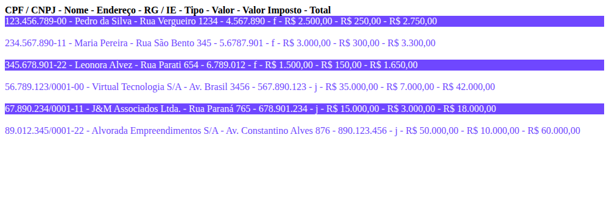

# Projeto Web LH Pets – Protótipo 1

Atividade 2 (SP3) – Codificação Back-End · SENAI · Turma CTMSP_DPE_QO_FULLST_252T01
Autor: Jeones de Souza

Aplicação web back-end em .NET (ASP.NET Core, `dotnet new web --use-program-main`) para a clínica LH Pets, com rotas configuradas no `Program.cs` e lista de clientes carregada de um banco de dados SQL Server.

## Rotas

| Rota | O que exibe |
|---|---|
| `/` | Versão inicial do projeto: **LH Pets - Protótipo 1** |
| `/index` | Página `wwwroot/index.html` fornecida pelo front-end (redirecionamento) |
| `/listaClientes` | Lista de clientes do banco `vendas` (tabela `tblclientes`), montada em HTML pelo back-end |




## Estrutura

| Arquivo | Função |
|---|---|
| `Program.cs` | Cria a aplicação, habilita arquivos estáticos (`UseStaticFiles`) e mapeia as rotas `/`, `/index` e `/listaClientes` |
| `Banco.cs` | Conecta ao SQL Server, lê `tblclientes` e guarda os registros na lista (atributo `private List<Clientes> lista`, com `GetLista()`); gera o HTML em `GetListaString()` |
| `Clientes.cs` | Classe com os atributos do cliente (CPF/CNPJ, nome, endereço, RG/IE, tipo, valor, imposto, total) |
| `vendas.sql` | Script que cria o banco `vendas`, a tabela `tblclientes` e insere 6 clientes |
| `wwwroot/index.html` | Página estática do front-end |

## Como executar

Pré-requisitos: .NET SDK, SQL Server (Express) e SQL Server Management Studio (SSMS).

1. No SSMS, conecte com o login `sa` (senha `12345`), abra `vendas.sql` e clique em **Executar**.
2. Confira em `Banco.cs` se o login, a senha e o servidor (`localhost\SQLEXPRESS`) são os mesmos da sua instalação.
3. No terminal, dentro da pasta do projeto:

```bash
dotnet restore
dotnet run
```

4. Abra o endereço exibido e teste as rotas `/`, `/index` e `/listaClientes`.

> Observação: o login `sa` é usado apenas por se tratar de hospedagem local, conforme o material da atividade.

## Pacotes

- `System.Data.SqlClient` (conector com o SQL Server)

Projeto gerado com .NET 8. Para usar .NET 6, altere `TargetFramework` para `net6.0` no arquivo `.csproj`.
